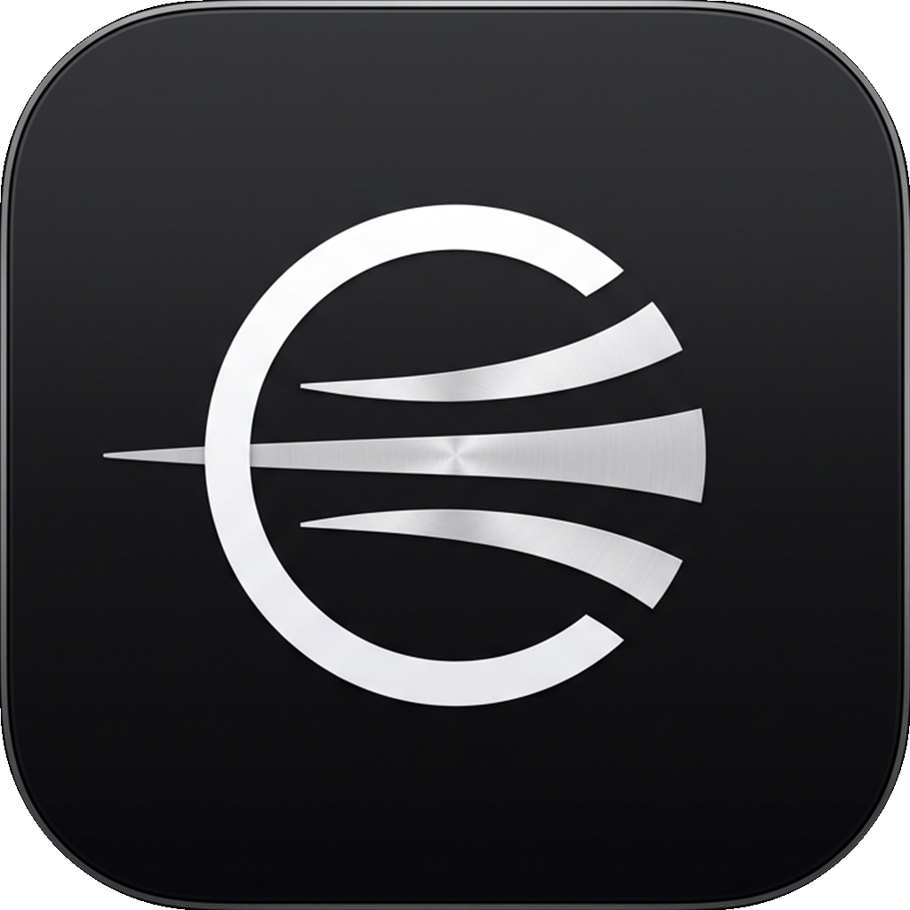

<div align="center">
  
  <h1>SpotiDesk</h1>
  <p>
    <strong>Cliente de escritorio ultraligero y minimalista de Spotify construido con Tauri v2 (Rust) y el Spotify Web Playback SDK oficial.</strong>
  </p>
  <p>
    
    
    
    
    
  </p>
</div>

---

## ¿Por qué SpotiDesk?

**SpotiDesk** reemplaza el cliente oficial basado en Electron/Chromium por una aplicación nativa impulsada por **Rust** y el WebView del sistema (**WebView2** en Windows / **WKWebView** en macOS), reduciendo drásticamente el consumo de RAM sin renunciar a la reproducción directa oficial de Spotify ni a un diseño sobrio estilo Apple.

- **Audio oficial sin `librespot`:** Streaming directo mediante el **Spotify Web Playback SDK** y **Spotify Web API** (compatible con los endpoints 2026 `/playlists/{id}/items`, `/me/library` y `POST /me/playlists`).
- **Autenticación OAuth 2.0 PKCE (S256):** Sin exponer *Client Secret*. El backend en Rust levanta un servidor HTTP temporal en `http://127.0.0.1:8888/callback`, valida `state` contra CSRF, guarda los tokens localmente y gestiona el *auto-refresh* de forma transparente.
- **Rendimiento cuidado:** Portadas con carga perezosa (*lazy loading*), listas virtualizadas con `@tanstack/react-virtual` para playlists de miles de canciones y cero *polling* agresivo (eventos en tiempo real del SDK).

---

## Características principales

### Diseño Monocromático (Obsidian & Porcelain)
- **Modo Oscuro (*Obsidian*)** por defecto y **Modo Claro (*Porcelain*)**, donde las portadas de los álbumes son el único acento de color.
- **Glassmorphism sutil** (`backdrop-filter: blur(24px)`) en la barra lateral y en la cápsula flotante de reproducción, tipografía con `tabular-nums` y resplandor ambiental opcional extraído de la portada activa.
- **Micro-interacciones cinéticas:** Gota de agua con ondas concéntricas al dar Play, micro-temblor háptico al pausar, zoom suave en playlists/álbumes y transiciones compartidas con **View Transitions API**.

### Widget Flotante de Escritorio (4 modos)
Configurable desde **Ajustes → Posición del Notch**, siempre visible sobre cualquier aplicación y con *click-through* automático en reposo:
1. **Notch Superior:** Cápsula tipo *Dynamic Island* acoplada al borde superior (con integración nativa para el notch físico en macOS).
2. **Notch Izquierdo / Derecho:** Píldora minimalista en el borde lateral que se infla suavemente al acercar el cursor.
3. **Burbuja Radial Arrastrable (*Drag & Drop*):** Burbuja circular con anillo de progreso en vivo que puedes arrastrar a cualquier punto del monitor. Al pasar el mouse despliega **6 burbujas satélite en abanico** (Anterior, Play/Pausa, Siguiente, Carátula, Me Gusta y Abrir app), adaptando automáticamente la orientación del arco según el cuadrante donde la sueltes.

### Experiencia de Música Completa
- **Vista Inmersiva + Letras Sincronizadas:** Presiona `F` (o haz clic en la portada) para expandir la carátula a pantalla completa y activar **letras sincronizadas en tiempo real** vía [LRCLIB](https://lrclib.net/) (haz clic en cualquier verso para saltar directamente a ese segundo).
- **Biblioteca y Buscador:** Inicio, Buscador instantáneo con *debounce* (canciones, álbumes, artistas), Tus Me Gusta, Álbumes guardados, Artistas seguidos y creación directa de playlists (`+`).
- **Menú Contextual (Clic Derecho):** *Reproducir ahora*, *Añadir a la cola*, *Me Gusta / Quitar*, *Añadir a playlist*, *Ver portada en pantalla*, *Ir al álbum* y *Copiar enlace*.
- **Panel de Cola, Spotify Connect y Reproducción Automática:** Cajón lateral para gestionar la cola en vivo, cambio de dispositivo Spotify Connect y continuación automática al terminar la cola.

### Integración Nativa de Escritorio
- **Bandeja del sistema (*System Tray*):** Opción de minimizar a la bandeja al cerrar la ventana sin detener la música, con controles rápidos desde el ícono.
- **Atajos multimedia globales:** `Play/Pause`, `Siguiente` y `Anterior` registrados a nivel de sistema operativo.
- **Controles nativos del SO:** Sincronización con el overlay de volumen y pantalla de bloqueo de **Windows 11 (SMTC / Media Session)** y **macOS Now Playing**.
- **Inicio automático (*Autostart*):** Configurable con un interruptor desde Ajustes.

---

## Requisitos previos

- **Cuenta de Spotify Premium** *(requerida por el Spotify Web Playback SDK para reproducir audio directamente en la app)*.
- **Node.js** `20+` y **pnpm** `9+`.
- **Rust** (`rustup` + `cargo`, edición 2024).
- En **Windows:** WebView2 Runtime (incluido por defecto en Windows 10/11) y Visual Studio C++ Build Tools.
- En **macOS:** Xcode Command Line Tools.

---

## Configuración de Spotify Developer

1. Entra al [Spotify Developer Dashboard](https://developer.spotify.com/dashboard) y crea una nueva aplicación.
2. En **APIs used**, marca **Web API** y **Web Playback SDK**.
3. En **Redirect URIs**, añade exactamente:
   ```text
   http://127.0.0.1:8888/callback
   ```
4. Copia tu **Client ID** *(no se necesita Client Secret gracias al flujo PKCE)*.
5. Crea tu archivo `.env` en la raíz del proyecto a partir de `.env.example`:
   ```powershell
   Copy-Item .env.example .env
   ```
   Y pega tu Client ID:
   ```env
   VITE_SPOTIFY_CLIENT_ID=tu_spotify_client_id
   ```

> **Nota sobre Spotify Development Mode:** Las apps personales funcionan en *Development Mode* para tu cuenta y hasta 5 usuarios añadidos en *User Management* del dashboard. Bajo las políticas actuales de la Spotify Web API (2026), las playlists de terceros que solo sigues no permiten listar sus pistas por API, pero SpotiDesk te avisa temporalmente y te permite reproducirlas directamente con normalidad.

---

## Instalación y ejecución

### Modo desarrollo
```bash
pnpm install
pnpm tauri dev
```

### Compilar instalador de producción
```bash
pnpm tauri build
```

Los instaladores optimizados (`LTO`, `opt-level = 3`, `strip = true`) se generan en:
- **Windows:** `src-tauri/target/release/bundle/nsis/` (`.exe`) y `src-tauri/target/release/bundle/msi/` (`.msi`)
- **macOS:** `src-tauri/target/release/bundle/dmg/` (`.dmg`) y `src-tauri/target/release/bundle/macos/` (`.app`)

---

## Atajos de teclado

| Atajo | Acción |
| --- | --- |
| `Espacio` | Reproducir / Pausar |
| `F` | Abrir / cerrar Vista Inmersiva y Letras |
| `Ctrl + K` / `Cmd + K` | Ir al Buscador instantáneo |
| `Esc` | Cerrar Vista Inmersiva, Ajustes, Cola o menús |
| `Teclas Multimedia` | Control global (Play/Pause, Siguiente, Anterior) |

---

## Estructura del proyecto

```text
SpotiDesk/
├── public/
│   └── spotidesk-icon.png         # Ícono oficial de SpotiDesk
├── src/
│   ├── components/
│   │   ├── CollectionView.tsx     # Vista de Playlist, Tus Me Gusta y Álbum
│   │   ├── CreatePlaylistModal.tsx# Modal de creación de playlists
│   │   ├── DesktopNotch.tsx       # Notch (Superior/Lateral) y Burbuja Radial Drag & Drop
│   │   ├── HomeView.tsx           # Pantalla de inicio editorial
│   │   ├── KineticEffects.tsx     # Efectos cinéticos (gota de agua y choque de pausa)
│   │   ├── LibraryView.tsx        # Álbumes guardados y Artistas seguidos
│   │   ├── LoginScreen.tsx        # Inicio de sesión PKCE minimalista
│   │   ├── NowPlayingStage.tsx    # Vista inmersiva + Letras sincronizadas (LRCLIB)
│   │   ├── PlayerBar.tsx          # Cápsula inferior flotante + Spotify Connect
│   │   ├── QueueDrawer.tsx        # Cajón lateral de cola de reproducción
│   │   ├── SearchView.tsx         # Buscador con debounce
│   │   ├── SettingsModal.tsx      # Ajustes (tema, Notch/Burbuja, autostart, bandeja)
│   │   ├── Sidebar.tsx            # Navegación lateral y lista de playlists
│   │   ├── SpotiDeskLogo.tsx      # Emblema vectorial monocromático
│   │   ├── TitleBar.tsx           # Barra superior frameless arrastrable
│   │   ├── TrackContextMenu.tsx   # Menú contextual con clic derecho
│   │   └── VirtualizedTrackList.tsx # Tabla virtualizada para playlists grandes
│   ├── hooks/
│   │   ├── useAmbientColor.ts     # Extracción ligera de color ambiental de la portada
│   │   ├── useLyrics.ts           # Integración con LRCLIB (letras sincronizadas)
│   │   ├── useSpotifyAuth.ts      # Sesión PKCE + auto-refresh proactivo
│   │   ├── useSpotifyPlayer.ts    # Web Playback SDK + Media Session (SMTC)
│   │   └── useTheme.ts            # Persistencia de tema Obsidian / Porcelain
│   ├── lib/
│   │   ├── format.ts              # Formateo de tiempos y normalización de pistas
│   │   └── spotifyApi.ts          # Cliente HTTP tipado para Spotify Web API
│   └── types/
│       └── spotify.ts             # Tipos de Web API y Web Playback SDK
└── src-tauri/
    ├── tauri.conf.json            # Configuración de ventana frameless, CSP y bundle
    ├── capabilities/default.json  # Permisos Tauri v2 para main y notch
    └── src/
        ├── auth.rs                # Servidor HTTP OAuth PKCE en 127.0.0.1:8888
        ├── lib.rs                 # Setup, Autostart, eventos de ventana y comandos
        ├── notch.rs               # Motor nativo de Notch/Burbuja (click-through y drag)
        ├── shortcuts.rs           # Atajos multimedia globales y macOS Now Playing
        └── tray.rs                # System Tray con controles y salida limpia
```

---

## Scopes de Spotify utilizados

`streaming` · `user-read-email` · `user-read-private` · `user-read-playback-state` · `user-modify-playback-state` · `user-library-read` · `user-library-modify` · `user-follow-read` · `playlist-read-private` · `playlist-read-collaborative` · `playlist-modify-public` · `playlist-modify-private`

---

## Aviso legal

SpotiDesk es un cliente independiente de terceros que utiliza exclusivamente la **Spotify Web API** y el **Spotify Web Playback SDK** oficiales. No está afiliado ni respaldado por Spotify AB.
